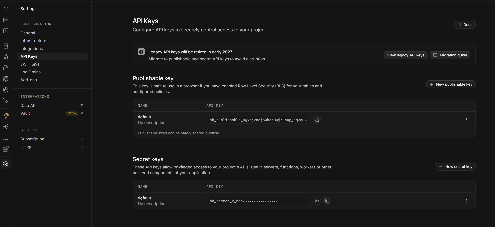

# Project Tracker

Project tracker with logins, roles, topology image uploads, comments and read-only share links.

- **Website:** static HTML/JS in the `docs/` folder, hosted free on **GitHub Pages** (`https://<your-github-user>.github.io/<repo-name>/`)
- **Back end:** **Supabase** (free): database, password login and image storage. All security rules are in `supabase-setup.sql`, so the website itself holds no secrets.

## Features
- Dark, dCloud-style look: navy background, dark rounded cards, blue pills and buttons, left menu with icons, project list as cards with sorting
- Add / edit / delete projects: status (Pending, In Progress, On Hold, Done), priority (Low, Medium, High), start date, due date, owner
- Progress bar on every project (0-100%): fills **automatically** from a task checklist, or you can set the % **manually**
- Documents per project: upload PDF, Word (.docx) or HTML files and read them in a built-in web view (also for share-link visitors)
- Upload topology images (PNG/JPEG/GIF/WebP; big ones are compressed automatically), click to enlarge
- Comments on every project
- Share link per project: a 3rd person (no account) can view and comment only. The link can be regenerated or disabled
- Users with username + password; the admin adds, edits, deletes users and changes roles
- Roles:

  | Role | Can do |
  |---|---|
  | **Admin** | Everything: all projects, add/modify/delete users, change roles, reset passwords |
  | **Project Owner** | Create projects; see, edit, delete and upload to **only their own projects** (they cannot see other owners' projects); comment on them |
  | **Reviewer** | View all projects (reviewers review everything); comment only |

---

## Setup: follow these steps in order (about 20 minutes)

You need: a GitHub account and an email address for a Supabase account. Nothing needs to be installed on your computer.

### Step 1. Create the Supabase project
1. Go to https://supabase.com and sign up / sign in.
2. Supabase first asks you to create an **organization** (just a container for your projects). Enter any name, choose type **Personal**, plan **Free**, and click **Create organization**.
3. Click **New project** (or open https://supabase.com/dashboard/projects). Choose any name (e.g. `project-tracker`), set a database password (click *Generate a password* and save it somewhere), pick the region closest to you, keep the **Free** plan, click **Create new project**.
4. Wait 1-2 minutes until the project finishes setting up.

### Step 2. Disable public sign-ups
Users are created only by the admin inside the app.
1. In Supabase left menu: **Authentication → Sign In / Providers** (older UI: *Authentication → Providers → Email*).
2. Turn **OFF** "Allow new users to sign up" (this is on the main Sign In / Providers page). Click **Save**.
3. **Important:** do NOT turn off the **Email** provider itself. Click **Email** in the provider list and make sure **Enable email provider** stays **ON**. If it is off, every login fails with a 422 error. The other switches in that panel (secure email change, magic links, etc.) can stay off.

### Step 3. Create tables and the first admin account (fresh install)
Because the repository will be **public**, never type your real admin password into any file in the repo. Edit it only inside the Supabase editor box:
1. On your computer open `supabase-setup.sql` in a text editor, select ALL text and copy it.
2. In Supabase left menu: **SQL Editor → New query**, and paste the text into the query box.
3. Scroll to the **last line** in the Supabase box:
   ```sql
   select public.bootstrap_admin('admin', 'CHANGE-ME-to-a-strong-password', 'Administrator');
   ```
   Change `admin` (your admin username) and `CHANGE-ME-to-a-strong-password` (your password, minimum 8 characters). Keep the quotes. Do **not** save this change back into the file.
4. Click **Run**.
5. You should see **Success**. If you see a red error, copy the message and ask for help. This one file already includes every feature (progress, tasks, documents, share links), so you do not need the `supabase-update-*.sql` files. Do not run the script twice: if it fails halfway, the simplest fix is to create a new Supabase project (Step 1) and start again.
6. Write down the admin username and password in your password manager. You will use them in Step 7.

### Step 4. Put the Supabase URL and key in the website
1. In Supabase click the **gear icon (Project Settings) → API Keys**. You will see this page:

   

2. Under **Publishable key**, click the **copy icon** next to the `default` key (it starts with `sb_publishable_`). This is the key you need. It is designed to be public.
   **Do NOT use the "Secret keys" section** (`sb_secret_...`). That key gives full access to your database; never put it in `config.js` or on GitHub.
3. Get the **Project URL** (looks like `https://abcdxyz.supabase.co`): it is shown under **Project Settings → Data API** (top of the page), and also behind the **Connect** button at the top of the dashboard. If you only find the Project ID (Project Settings → General), the URL is `https://<project-id>.supabase.co`.
4. Open `docs/config.js` and replace the two placeholder values:
   ```js
   window.APP_CONFIG = {
     SUPABASE_URL: 'https://abcdxyz.supabase.co',
     SUPABASE_ANON_KEY: 'sb_publishable_xxxxxxxxxxxxxxxx',
   };
   ```
   (The variable is named `ANON_KEY` but it takes the publishable key.) Save the file.

### Step 5. Upload the code to GitHub
**Public repo checklist (do this before uploading):**
- `docs/config.js` contains only the Supabase **Project URL** and the **publishable** key. This is fine to publish.
- No `sb_secret_...` / `service_role` key anywhere in any file.
- `supabase-setup.sql` still has the placeholder `CHANGE-ME-to-a-strong-password` on its last line (no real password).

Option A: web page (no tools needed)
1. Go to https://github.com/new, name the repository (e.g. `project-tracker`), choose **Public** (GitHub Pages on the free plan needs a public repo), click **Create repository**.
2. Click **uploading an existing file**.
3. Drag the **contents** of the `project-tracker` folder into the page: the `docs` folder (with everything inside, including `vendor`), the `images` folder, `supabase-setup.sql`, the six `supabase-update-*.sql` files, `README.md`, `.gitignore`.
   - Tip: if folders do not upload by drag-and-drop, open the folder in Windows Explorer, select everything inside, and drag it into the browser.
   - Make sure the files `docs/.nojekyll`, `docs/vendor/supabase.js` and `docs/vendor/mammoth.js` were uploaded.
4. Click **Commit changes**.

Option B: Git on the command line
```
cd project-tracker
git init
git add .
git commit -m "Project tracker"
git branch -M main
git remote add origin https://github.com/<your-user>/project-tracker.git
git push -u origin main
```

### Step 6. Turn on GitHub Pages
1. In your repo: **Settings → Pages**.
2. Under **Build and deployment → Source**, choose **Deploy from a branch**.
3. Branch: **main**, folder: **/docs**, click **Save**.
4. Wait 1-2 minutes and refresh the page. A banner shows your site address: `https://<your-github-user>.github.io/<repo-name>/`.

### Step 6b. Protect the public repo (recommended, 2 minutes)
People can read and copy a public repo, but only you can change it. To keep it that way:
1. Turn on **two-factor authentication** for your GitHub account (GitHub → Settings → Password and authentication). This protects against the real risk: someone taking over your account.
2. Repo **Settings → Branches → Add branch ruleset** (or *Add rule*) for `main`, and enable **Require a pull request before merging**. Outsiders can only propose changes (pull requests); nothing is published unless you merge it.
3. Do not add collaborators you do not trust. Never commit passwords or secret keys.

Even if someone copies the code, your data is safe: it lives in your Supabase project and is protected by the login and the database rules.

### Step 7. Sign in
1. Open the site address from Step 6.
2. Sign in with the admin username and password from Step 3.
3. Click **Users** in the top bar and add your project owners and reviewers (username, name, password, role). Give them their credentials. They can change their own password with **Change password**.
4. Click **Projects → + New project** to start.

---

## How to use

**Project page layout:** a full-width bar on top with the title, status, priority, dates, owner and progress; the task list under it; small boxes for Documents, Topologies and Sharing on the left; and the comment chat on the right. On phones everything stacks into one column.

- **Create project:** Projects → + New project (admins and project owners).
- **Change status / priority:** open the project, use the drop-downs at the top (owner of the project or admin).
- **Progress bar:** shown in the project list and on the project page. Two modes, chosen in **Edit** (owner of the project or admin):
  - **Automatic** (default): open the project and add tasks in the **Tasks** card. Each task has a status and its own bar: **Not started** (0%, default), **In progress** (its own %, 50% to begin with, adjustable with the slider in the task's Edit) and **Completed** (100%). The project bar is the average of all task bars (one Completed, one In progress at 50%, two Not started = 38%). Statuses only change when you change them. Until the first task is added, the bar shows the % you set in Edit.
  - **Manual**: you move the 0-100 slider in Edit and the bar always shows that value.
  Reviewers and people with a share link see the bar and the task list but cannot change them.
- **Documents:** open the project, use the file picker in the **Documents** card (PDF, .docx or HTML, max 20 MB, 20 per project), then click **View** to read it in the page. PDFs use the browser viewer; Word files are converted to a web page; HTML runs in an isolated frame (its own tabs/scripts work, but it cannot reach the site, your login or the network). Admins and the project owner upload and delete; everyone else, including share-link visitors, can view.
- **Topologies:** open the project, use the file picker in the Topologies card, click an image to enlarge. To add a **screenshot**, take it (Win+Shift+S), then press **Ctrl+V** anywhere on the project page or click **Paste screenshot**.
- **Comments:** shown as a chat (your messages on the right, others on the left). Type at the bottom of the project page and click Post comment (any signed-in user). Click **Edit** under your own message to change it (it then shows "(edited)"); you can delete your own comments, and admins can delete any.
- **Share with someone without an account:** open the project → *Share with a 3rd person* → **Create share link** → **Copy link** and send it. They can view and comment only. **Disable** stops the link working; **Regenerate** replaces it.
- **Privacy between users:** a project owner only sees their own projects, tasks, documents, topologies and comments. This is enforced by the database (Row Level Security), so it also holds if someone tries the API directly. Admins and reviewers see every project.
- **Admin dashboard links (all users or chosen users):** Projects page -> **Share dashboard**. In **Create a new link** give it a name, open the **Whose projects?** dropdown, tick **All users** or only the users you want, and click **Create link**. Create as many links as you like (one per audience). **Change users** edits who a link shows, **Regenerate** gives it a new address, **Delete** removes it. Visitors see only the chosen users' projects and a title saying whose projects they are.
- **Share your dashboard (project owners):** Projects page → **Share dashboard** → **Create dashboard link** → **Copy link**. Anyone with the link sees the projects and their status without logging in, can open a project to see its details and topologies, and can add comments, but cannot change anything. A **project owner's** link shows **only the projects that owner owns**; each owner has one link. Admins use the multi-link dialog described above. **Regenerate** replaces your link (the old one stops working); **Disable** turns it off.
- **Projects by user (admin):** the admin's Projects page hides everyone's projects by default. The **Projects by user** menu lists every user (name, role, number of projects) with their projects collapsed; click **Show projects** next to a user to see only that person's projects, or use **Show all projects** on the Projects page. Everything is hidden again after a reload. This hides projects on screen only; an admin account still has full rights in the database.
- **Activity log (admin):** the **Activity log** menu item lists who did what and when: sign-ins, project / task / document / topology / comment changes, user changes and sharing links. The database records it by itself (it cannot be skipped from the browser), only admins can read it, and **every entry is deleted automatically after 72 hours** (hourly clean-up with `pg_cron` when Supabase has it enabled, plus a clean-up on every new entry and a 72-hour read filter). Passwords and share-link addresses are never logged. Use **Export CSV** to keep a copy.
- **Manage users (admin):** Users page. Change the role from the drop-down, **Reset password**, or **Delete**. The last admin cannot be deleted or demoted.

## The SQL files: which one to run, and in what order

All database changes are plain SQL files that you paste into the Supabase **SQL Editor**. Which ones you need depends on your situation.

| File | What it adds | When to run it |
|---|---|---|
| `supabase-setup.sql` | **Everything**: tables, security rules, storage, share links, progress and tasks, documents, and the first admin | **Fresh install only, once** (Step 3). Never on a database that already has data: it fails with `relation "profiles" already exists`. |
| `supabase-update-dashboard-share.sql` | The shareable dashboard link (admin and owner links) | Existing install, update **1 of 6** |
| `supabase-update-progress.sql` | Progress bar, task list with statuses, progress in share links | Existing install, update **2 of 6** |
| `supabase-update-documents.sql` | Documents (PDF / Word / HTML) and their storage | Existing install, update **3 of 6** |
| `supabase-update-comments.sql` | Editing your own comments (chat-style comments) | Existing install, update **4 of 6** |
| `supabase-update-logs.sql` | Admin-only activity log, auto-deleted after 72 hours | Existing install, update **5 of 6** |
| `supabase-update-privacy.sql` | Each project owner only sees their own projects; admin share links for all users or chosen users | Existing install, update **6 of 6** |

### A) New install (nothing in Supabase yet)
Run **only** `supabase-setup.sql`, as described in Step 3. It already contains all six updates below, so do not run the update files.

### B) Existing install (you already have the app and data)
Never run `supabase-setup.sql` again. Run the update files **in this order**, skipping any you have already run (they are all safe to run again):

1. `supabase-update-dashboard-share.sql`
2. `supabase-update-progress.sql`
3. `supabase-update-documents.sql`
4. `supabase-update-comments.sql`
5. `supabase-update-logs.sql`
6. `supabase-update-privacy.sql`

### How to run one SQL file (the same every time)
1. On your computer open the file in a text editor (Notepad is fine), press **Ctrl+A** to select everything and **Ctrl+C** to copy.
2. Open https://supabase.com/dashboard, click your project, then **SQL Editor** in the left menu.
3. Click **New query**. Click inside the big box and press **Ctrl+V** to paste.
4. Click the green **Run** button (or press Ctrl+Enter).
5. Wait for **Success. No rows returned** at the bottom. That is the normal result.
6. If you see a red error, copy the message and look it up in the Troubleshooting table below.
7. Repeat for the next file in the order above.

### After the SQL: upload the website files
The SQL only changes the database. The new screens come from the website files, so after each update upload the new versions to GitHub (**Add file → Upload files**, drag them in, **Commit changes**):

| Update | Files to upload |
|---|---|
| Dashboard share | `docs/app.js` |
| Progress and tasks | `docs/app.js`, `docs/style.css` |
| Documents | `docs/app.js`, `docs/style.css`, and the new file `docs/vendor/mammoth.js` (the Word converter, about 640 KB) |
| Per-user privacy and admin share links, activity log, Projects by user, edit comments (chat-style), new page layout, dark dCloud-style theme | `docs/app.js`, `docs/style.css`, `docs/index.html` (the theme adds the left menu to `index.html`) |
| Paste screenshots, user guide, signature | `docs/app.js`, `docs/style.css`, `docs/index.html` |

When in doubt, upload the whole `docs` folder again (keep the `vendor` folder inside it). Wait about a minute, then open the site and press **Ctrl+Shift+R** to load the new version.

**Order matters:** run the SQL **first**, then upload the website files. The new website code asks the database for columns that do not exist until the SQL has run, and shows errors such as `column tasks_1.status does not exist`.

### Notes
- `supabase-update-documents.sql` and `supabase-update-comments.sql` also redefine a shared function that `supabase-update-progress.sql` defines. If you ever re-run the progress or documents file, run the comments file again afterwards (it holds the final version).
- Documents are stored in a public Supabase bucket named `documents` with unguessable file names, like the topology images: anyone who has a file's exact address can open it, so do not upload anything that must stay strictly secret.
- The update files contain no passwords or keys, so it is fine to keep them in the public repo.
## Updating the site later
Edit the files and upload/push them again to GitHub; GitHub Pages republishes automatically in about a minute. Database changes are made in the Supabase SQL Editor.

## Troubleshooting
| Problem | Fix |
|---|---|
| Page says **"Setup needed"** | `docs/config.js` still has the placeholders. Fill in URL and key (Step 4) and re-upload. |
| **"Invalid username or password"** | Use the username exactly as in the SQL (case does not matter). Admin password is the one you typed in the Supabase SQL editor in Step 3. Forgot the admin password? Run in the Supabase SQL Editor: `update auth.users set encrypted_password = extensions.crypt('NEW-PASSWORD', extensions.gen_salt('bf')) where email = 'admin@tracker.example.com';` (replace `admin` with your admin username). |
| "This account has no access" | The user exists in Supabase Auth but not in the app. Create users only from the app's Users page. |
| Sign in fails with "Email logins are disabled" (HTTP 422) | Supabase → Authentication → Sign In / Providers → **Email** → turn **Enable email provider** ON and Save. |
| Sign in works but page says "Could not read your profile" (HTTP 403) | Run the three `grant` lines from `supabase-setup.sql` (section "permissions for logged-in users") in the SQL Editor. |
| Network error / blank page on sign in | Your network may block `*.supabase.co`. Ask IT to allow it, or try another network to confirm. |
| Site is 404 on GitHub | Check Settings → Pages is set to `main` / `/docs`, and that `docs/index.html` exists in the repo. |
| Site worked, now errors after a long pause | Free Supabase projects pause after ~1 week of inactivity. Open the Supabase dashboard and click **Restore project**. |
| Upload of image fails | Only PNG, JPEG, GIF, WebP are accepted; max 20 images per project. |
| `relation "profiles" already exists` (42P07) when running SQL | You ran `supabase-setup.sql` on a database that is already set up. Run only the `supabase-update-*.sql` files instead (see "The SQL files"). |
| `column tasks_1.status does not exist`, or "Could not find the column ... in the schema cache" | The website is newer than the database. Run the missing `supabase-update-*.sql` files in order (see "The SQL files"), then press Ctrl+Shift+R. |
| `relation "public.tasks" does not exist` or `function public._project_payload` errors when running an update file | An earlier update file was skipped. Run them in order: dashboard-share, progress, documents, comments. |
| Word documents show "Could not load the Word viewer" | `docs/vendor/mammoth.js` was not uploaded to GitHub. Upload it and refresh. |
| Project owners still see other owners' projects, or the admin Share dashboard says "has supabase-update-privacy.sql been run?" | Run `supabase-update-privacy.sql` (update 6 of 6). If you ever re-run an earlier update file, run the privacy file again afterwards. |
| Activity log page says it could not load, or stays empty | `supabase-update-logs.sql` has not been run. Run it (update 5 of 5), then reload. Entries only appear for actions done after it ran. |
| Editing a comment says "Not allowed" or the edit is not saved | `supabase-update-comments.sql` has not been run. Run it, then try again. |
| Documents upload fails with a permission error | `supabase-update-documents.sql` has not been run (or failed). Run it, then try again. |

## Security notes
- Passwords are stored hashed by Supabase Auth. Permissions are enforced by the database (Row Level Security), not just the page.
- Usernames are mapped internally to `username@tracker.example.com`; no real email is used or sent.
- Image and document links are random and unguessable but not password protected: anyone who has the exact URL of an image or document can open it.
- Share links are secret URLs: anyone holding the link can view and comment on that one project.
