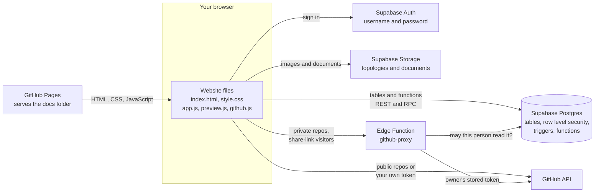
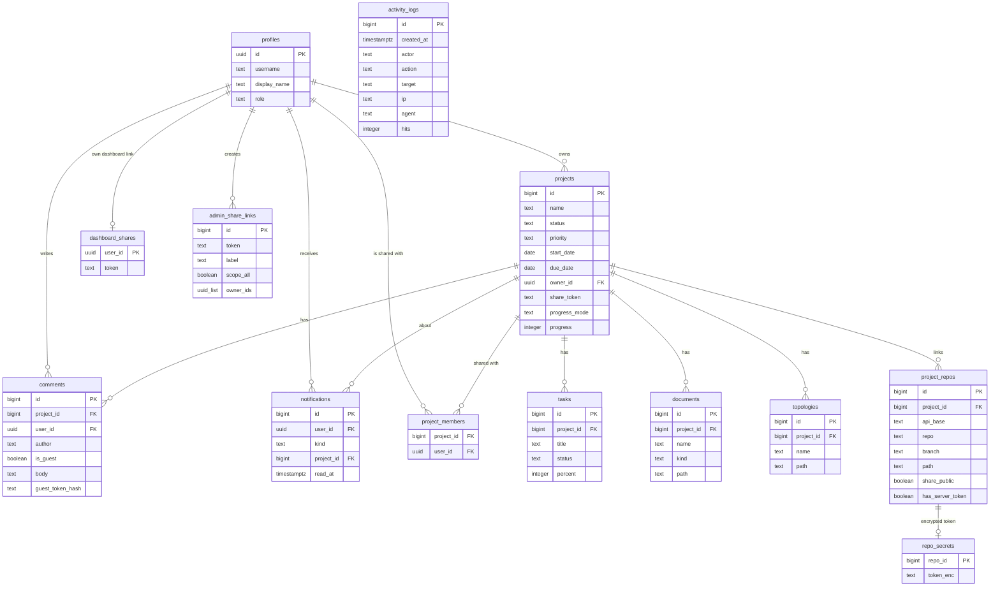
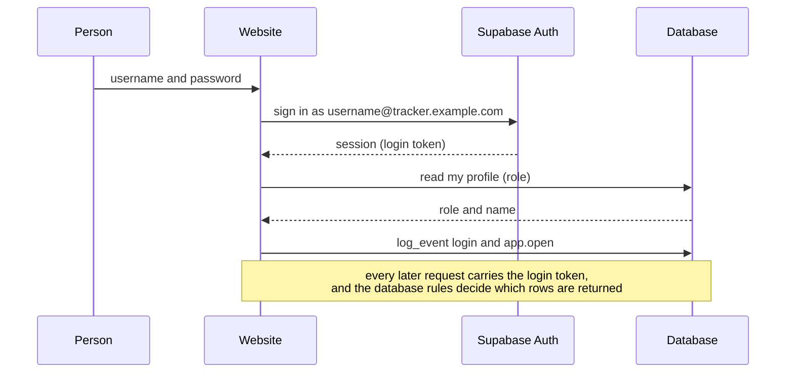
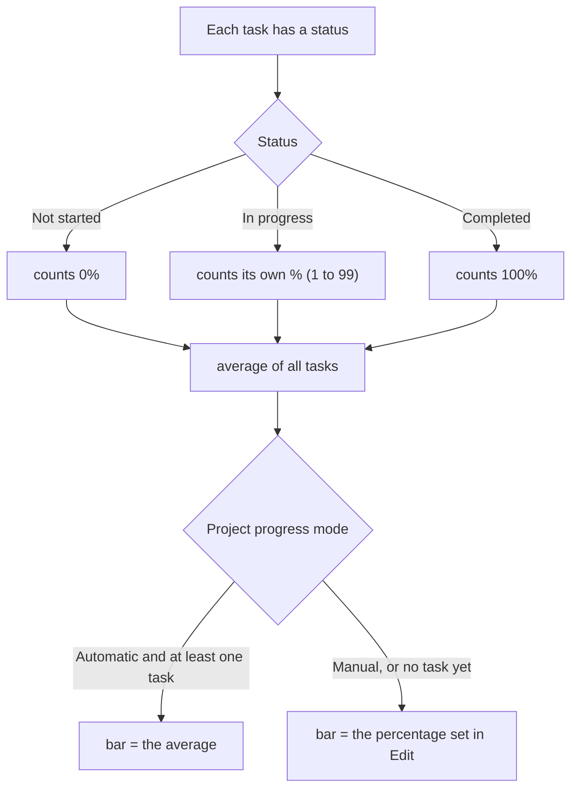
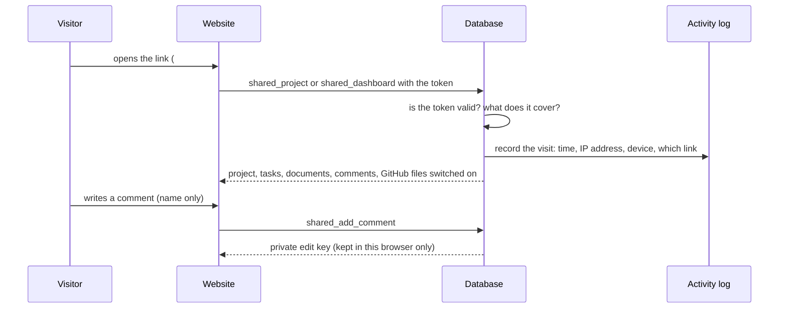
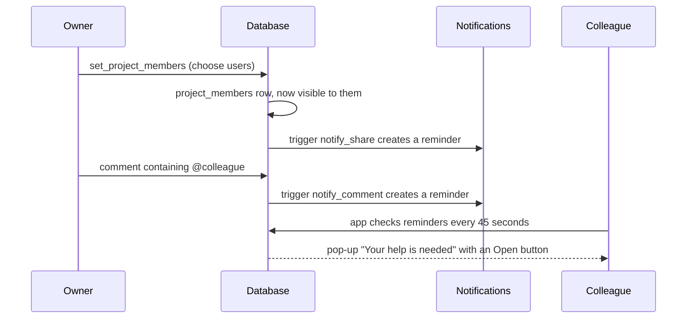
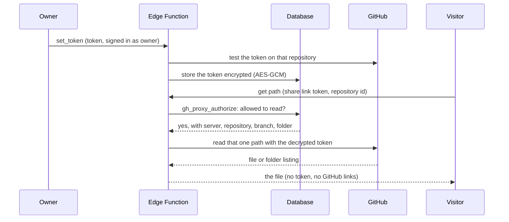
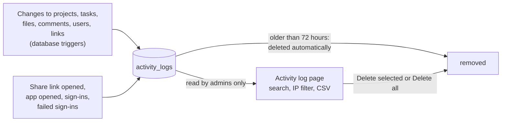

# Project Tracker

Project tracker with logins, roles, per-user privacy, project sharing with @tags and reminders, progress bars and task lists, documents, topology images, chat-style comments, read-only share links and an admin activity log.

- **Website:** static HTML/JS in the `docs/` folder, hosted free on **GitHub Pages** (`https://<your-github-user>.github.io/<repo-name>/`)
- **Back end:** **Supabase** (free): database, password login and image storage. All security rules are in `supabase-setup.sql`, so the website itself holds no secrets.

## Features
- Dark, dCloud-style look: navy background, dark rounded cards, blue pills and buttons, left menu with icons, project list as cards with sorting, signature footer and a browser tab icon
- Projects: status (Pending, In Progress, On Hold, Done), priority (Low, Medium, High), start date, due date or "No due date", with due-soon / overdue warnings and a daily pop-up. Finished projects sink to the bottom of the list
- Progress bar on every project (0-100%): fills **automatically** from a numbered task list (each task: Not started / In progress with its own % / Completed, in grey / orange / green) or you set the % **manually**
- Documents per project: upload PDF, Word (.docx), Excel (.xlsx, .xls), PowerPoint (.pptx) or HTML files and read them in a large built-in web view (also for share-link visitors)
- **GitHub repositories:** link a repository (public or private) to a project, browse its files and view them in the page: PDF, Word, Excel, PowerPoint, HTML, images including **SVG**, and text/code. Private repositories use each person's own access token (kept only in their own browser), or a token the owner stores once on the server (encrypted) so that everyone, and share-link visitors, can read the files without ever receiving it
- Topology images (PNG/JPEG/GIF/WebP; big ones are compressed automatically): click to enlarge, **paste screenshots with Ctrl+V**, watermark and copy/download deterrents
- Comments shown as a chat; you can edit your own messages, and visitors with a share link can edit or delete the comments they wrote
- **Per-user privacy:** a Project Owner only sees their own projects (enforced by the database), plus projects other owners **share with them**. Shared users can read and comment, not change. Tag people with **@** in comments
- Share links without an account (view + comment only): one link per project, a personal dashboard link for each owner, and for admins **any number of dashboard links for all users or only chosen owners**
- Users with username + password; the admin adds, **edits (username, display name)**, deletes users, resets passwords and changes roles. Admins can hide/show each user's projects
- **Reminders:** when someone tags you with @ or shares a project with you, a warning pop-up "Your help is needed" opens on your screen (with a bell and count at the top right) and comes back after 10 minutes if you choose "Remind me later"
- **Activity log** (admin only): who did what and when, **and the public IP address and device where the app and the share links are opened from** (also failed sign-ins). Entries are deleted automatically after 72 hours, and an admin can also **delete entries by hand** (selected ones, or all)
- Roles:

  | Role | Can do |
  |---|---|
  | **Admin** | Manages the system: sees all projects, add/modify/delete users, change roles, reset passwords, creates share links, reads (and can delete entries of) the activity log. **Admins do not own or create projects**: every project belongs to a Project Owner, who creates it |
  | **Project Owner** | Create projects; see, edit, delete and upload to **only their own projects**; see (read + comment, not change) projects other owners **shared with them**; share their own projects; they cannot see any other project |
  | **Reviewer** | View all projects (reviewers review everything); comment only |

---

## Contents

1. [SCIPAB: why this project exists](#scipab-why-this-project-exists)
2. [How it works](#how-it-works): [architecture](#1-architecture), [files and functions](#2-the-website-files-and-their-main-functions), [who can do what](#3-who-can-do-what), [database diagram](#4-the-database), [key flows](#5-how-the-main-features-work), [security layers](#6-security-layers), [data kept and for how long](#7-data-kept-and-for-how-long)
3. [Setup, step by step](#setup-follow-these-steps-in-order-about-20-minutes)
4. [How to use](#how-to-use) and [the SQL files](#the-sql-files-which-one-to-run-and-in-what-order)
5. [Troubleshooting](#troubleshooting) and [security notes](#security-notes)

> The diagrams below are written in **Mermaid**. GitHub draws them automatically when you open this README on GitHub. In VS Code install a "Mermaid" preview extension to see them in the editor.

---

## SCIPAB: why this project exists

SCIPAB = **S**ituation, **C**omplication, **I**mplication, **P**osition, **A**ction, **B**enefit.

| | |
|---|---|
| **Situation** | Teams run network, lab and customer projects with many parts: a status and a due date, a list of tasks, topology drawings, design documents (PDF, Word, Excel, PowerPoint), files in GitHub, and conversations. Several project owners work in parallel and people outside the team (customers, managers) want to follow progress. |
| **Complication** | The information is scattered over spreadsheets, e-mail, chat and repositories, so nobody has one reliable view. Sharing with people who have no account means e-mailing copies of confidential topologies and documents. Each owner must see only their own work, yet reviewers and managers need an overview. There is no record of who opened or changed what, and commercial project-management tools need accounts, licences and approvals (and some hosting is blocked on the corporate network). |
| **Implication** | Status is out of date, due dates are missed and work is duplicated. Confidential drawings spread in uncontrolled copies. Without an audit trail, a leak or a wrong change cannot be traced, and the team spends time asking "where is the latest version?" instead of delivering. |
| **Position** | A small, self-service **project tracker** that runs for free: a static website (GitHub Pages) plus a Supabase back end. It keeps **one place per project** (status, priority, dates, progress calculated from tasks, documents, topologies, GitHub files, a comment chat), enforces **who sees what in the database itself**, shares through **read-only links** (no account needed) and keeps an **admin-only activity log** that records who did what and from which IP address, deleted automatically after 72 hours. |
| **Action** | 1) The administrator installs it once (about 20 minutes, Steps 1-7 below) and creates the Project Owner users. 2) Each owner creates their projects, adds tasks, uploads documents and topologies and links GitHub repositories. 3) Owners share a project with other owners (and tag them with @), or send a read-only link to people without an account. 4) The administrator creates dashboard links for chosen owners and watches the activity log. |
| **Benefit** | One reliable, always-current view; progress is calculated automatically from the tasks. Confidential material is shared by link instead of copies, and each link can be cut off at any moment. Owners cannot see each other's projects unless they share them. Everything is traceable for 72 hours, there are no servers to maintain, no licence cost, and the whole source is small enough to read and adapt. |

---

## How it works

### 1. Architecture



* The **website** is only static files. It contains no secrets: the Supabase URL and the *publishable* key are public by design.
* **Everything that matters is enforced in the database** (Row Level Security and database functions), not in the page. Even someone who bypasses the page cannot read data the rules do not allow.
* The **Edge Function** exists for one job: reading a *private* GitHub repository on behalf of people who have no GitHub access, without ever giving them the token.

### 2. The website files and their main functions

| File | What it does | Main functions |
|---|---|---|
| `docs/index.html` | The page shell: top bar, left menu, content area, signature footer. Loads the scripts in this order: `preview.js`, `github.js`, `app.js`. | |
| `docs/style.css` | The dark look, the layouts (project page, cards, chat), colours for statuses. | |
| `docs/app.js` | The application. **Data layer `D`**: every call to Supabase (`login`, `projects`, `project`, `shared`, `sharedDashboard`, `createProject`, `updateProject`, `addComment`, `uploadTopology`, `uploadDocument`, `addTask`, `setProjectMembers`, `logs`, `deleteLogs` ...). **Screens**: `renderLogin`, `renderList` (cards), `renderDetail` (project page), `renderSharedDashboard`, `renderUsers`, `renderUserPage`, `renderLogs`, `renderHelp`. **Dialogs**: `projectDialog`, `dashboardShareDialog`, `adminShareDialog`, `userEditDialog`. **Helpers**: `h()` builds page elements safely (text only, never HTML), `route()` shows the screen for the address after `#`, `progressOf()` calculates progress, `checkNotifications()` shows the "Your help is needed" pop-up. | `route`, `D.*`, `render*` |
| `docs/preview.js` | Shows files inside the page: PDF, Word (`mammoth`), Excel (`SheetJS`), PowerPoint (`JSZip`), HTML (sandboxed frame), images including SVG, text. | `renderPreview`, `previewSheet`, `previewSlides` |
| `docs/github.js` | GitHub: link a repository, test access, browse files, credentials, the "Server access" token dialog. | `ghRequest`, `ghProxy`, `ghList`, `ghFileBytes`, `parseRepoInput`, `ghBrowserDialog`, `ghCard` |
| `docs/vendor/*.js` | Third-party libraries kept in the repository (no CDN at run time): Supabase client, Mammoth, SheetJS, JSZip. | |
| `docs/config.js` | Your Supabase URL and publishable key. | |
| `supabase/functions/github-proxy/index.ts` | The Edge Function (copied into Supabase, not part of the website). | `set_token`, `clear_token`, `get` |
| `supabase-setup.sql` and `supabase-update-*.sql` | The database: tables, security rules, triggers and functions. | |

How a screen is shown: the address after `#` (for example `#/project/12`, `#/share/abc...`, `#/users`) is read by `route()`, which asks the data layer for the data and builds the screen. Share-link addresses (`#/share/...`, `#/dash/...`) are public and use only the share functions.

### 3. Who can do what

| | Admin | Project Owner | Reviewer | Share-link visitor |
|---|---|---|---|---|
| See projects | all (hidden on screen until shown) | their own + projects shared with them | all | only what the link covers |
| Create a project | no | yes | no | no |
| Edit project, tasks, documents, topologies, GitHub links | any project | their own | no | no |
| Comment | yes | on projects they can see | yes | yes (with a name; can edit/delete their own) |
| Share with other owners, tag with @ | yes | their own projects | no | no |
| Share links | dashboard links for all or chosen owners | project link and own dashboard link | no | - |
| Manage users and roles | yes | no | no | no |
| Activity log (IP addresses, delete entries) | yes | no | no | no |

### 4. The database



`activity_logs` has no links to the other tables on purpose: it is a plain journal that is deleted after 72 hours. Besides the tables, two **storage buckets** hold the files: `topologies` (images) and `documents` (PDF, Word, Excel, PowerPoint, HTML). Their file names are random and contain the project number.

| Table | Purpose | Who can read it |
|---|---|---|
| `profiles` | one row per user: username, display name, role (`admin`, `owner`, `reviewer`). Linked to the Supabase login. | yourself; admins and reviewers read all |
| `projects` | the project: status, priority, dates, owner, progress mode and manual percentage, project share-link token | admin, reviewer, the owner, and users it is shared with |
| `tasks` | the checklist; each task is *not started* (0%), *in progress* (its own %) or *completed* (100%) | same as the project |
| `documents`, `topologies`, `comments` | uploaded documents, topology images, the chat | same as the project (visitors through the share functions) |
| `project_members` | which other Project Owners a project is shared with | handled by functions only |
| `project_repos` | linked GitHub repositories: only the **reference** (server, owner/name, branch, folder) and two switches | people who can see the project |
| `repo_secrets` | the owner's GitHub token, **encrypted**, written only by the Edge Function | nobody from a browser |
| `notifications` | the "Your help is needed" reminders (tagged / project shared) | only the person it is for |
| `dashboard_shares`, `admin_share_links` | the secret tokens of dashboard links (an owner's own link; the admin's links for all or chosen owners) | handled by functions only |
| `activity_logs` | who did what, when, from which IP address and device | admins only |

**Database functions** (called by the website): `shared_project`, `shared_dashboard`, `shared_dashboard_project` (open a share link), `shared_add_comment`, `shared_dashboard_comment`, `shared_edit_comment`, `shared_delete_comment` (visitors), `admin_create_user`, `admin_update_user`, `admin_edit_user`, `admin_delete_user`, `admin_*_share_link`, `set_project_members`, `leave_project`, `project_people`, `shareable_users`, `log_event`, `log_login_failed`, `admin_delete_logs`, `admin_clear_logs`. **Triggers** do the automatic work: calculate task percentages, stamp comment edits, create reminders (`notify_share`, `notify_comment`), refuse projects owned by non-owners, and write the activity log.

### 5. How the main features work

**Sign in and what you may see**



**Progress of a project**



**A visitor opens a share link, and it is logged**



**Sharing with another owner, tagging and reminders**



**A private GitHub repository for people without access**



**The activity log**



### 6. Security layers

1. **No secrets in the website**: only the public Supabase URL and the publishable key. Your personal GitHub token stays in your own browser; the owner's server token is encrypted and never sent to any browser.
2. **Login**: Supabase Auth (passwords are hashed); there is no public sign-up, only admins create users.
3. **Row Level Security**: every table has rules, so a person only receives the rows they may see, even if they call the API by hand. Project Owners see only their own projects and the ones shared with them.
4. **Share links are separate doors**: visitors have no table access at all; they can only call the share functions with a secret token, which return exactly what that link covers. Links can be regenerated or disabled at any time.
5. **Safe rendering**: file content is shown only as text, in sandboxed frames (HTML, Word) or as images; scripts in uploaded HTML cannot reach the site, your login or the network.
6. **Audit**: the activity log (with IP addresses) written by the database, readable only by admins.
7. **Limits and abuse guards**: guest comments are rate limited; log entries per address are capped; uploads are limited in size and type.

### 7. Data kept and for how long

| Data | Kept until |
|---|---|
| Projects, tasks, documents, topologies, comments, GitHub links | someone deletes them (deleting a project deletes everything inside it) |
| Activity log, including IP addresses and devices | **72 hours**, or earlier if an admin deletes them (hourly clean-up with `pg_cron` if enabled, plus a clean-up on every new entry) |
| Reminders ("Your help is needed") | until marked as read, and at most 30 days |
| Share links | until you disable, regenerate or delete them |
| The owner's stored GitHub token | until the owner removes it (or the repository is unlinked) |
| Your personal GitHub token | until you close the tab, or until you remove it (if you ticked "Remember on this device") |

---

## Setup: follow these steps in order (about 20 minutes)

You need: a GitHub account and an email address for a Supabase account. Nothing needs to be installed on your computer.

### Step 1. Create the Supabase project
1. Go to https://supabase.com and sign up / sign in.
2. Supabase first asks you to create an **organization** (just a container for your projects). Enter any name, choose type **Personal**, plan **Free**, and click **Create organization**.
3. Click **New project** (or open https://supabase.com/dashboard/projects). Choose any name (e.g. `project-tracker`), set a database password (click *Generate a password* and save it somewhere), pick the region closest to you, keep the **Free** plan, click **Create new project**.
4. Wait 1-2 minutes until the project finishes setting up.

### Step 2. Disable public sign-ups
Users are created only by the admin inside the app.
1. In Supabase left menu: **Authentication → Sign In / Providers** (older UI: *Authentication → Providers → Email*).
2. Turn **OFF** "Allow new users to sign up" (this is on the main Sign In / Providers page). Click **Save**.
3. **Important:** do NOT turn off the **Email** provider itself. Click **Email** in the provider list and make sure **Enable email provider** stays **ON**. If it is off, every login fails with a 422 error. The other switches in that panel (secure email change, magic links, etc.) can stay off.

### Step 3. Create tables and the first admin account (fresh install)
Because the repository will be **public**, never type your real admin password into any file in the repo. Edit it only inside the Supabase editor box:
1. On your computer open `supabase-setup.sql` in a text editor, select ALL text and copy it.
2. In Supabase left menu: **SQL Editor → New query**, and paste the text into the query box.
3. Scroll to the **last line** in the Supabase box:
   ```sql
   select public.bootstrap_admin('admin', 'CHANGE-ME-to-a-strong-password', 'Administrator');
   ```
   Change `admin` (your admin username) and `CHANGE-ME-to-a-strong-password` (your password, minimum 8 characters). Keep the quotes. Do **not** save this change back into the file.
4. Click **Run**.
5. You should see **Success**. If you see a red error, copy the message and ask for help. This one file already includes every feature (progress, tasks, documents, comments editing, activity log, privacy, share links, user editing), so you do not need the `supabase-update-*.sql` files. Do not run the script twice: if it fails halfway, the simplest fix is to create a new Supabase project (Step 1) and start again.
6. Write down the admin username and password in your password manager. You will use them in Step 7.

### Step 4. Put the Supabase URL and key in the website
1. In Supabase click the **gear icon (Project Settings) → API Keys**. You will see this page:

   

2. Under **Publishable key**, click the **copy icon** next to the `default` key (it starts with `sb_publishable_`). This is the key you need. It is designed to be public.
   **Do NOT use the "Secret keys" section** (`sb_secret_...`). That key gives full access to your database; never put it in `config.js` or on GitHub.
3. Get the **Project URL** (looks like `https://abcdxyz.supabase.co`): it is shown under **Project Settings → Data API** (top of the page), and also behind the **Connect** button at the top of the dashboard. If you only find the Project ID (Project Settings → General), the URL is `https://<project-id>.supabase.co`.
4. Open `docs/config.js` and replace the two placeholder values:
   ```js
   window.APP_CONFIG = {
     SUPABASE_URL: 'https://abcdxyz.supabase.co',
     SUPABASE_ANON_KEY: 'sb_publishable_xxxxxxxxxxxxxxxx',
   };
   ```
   (The variable is named `ANON_KEY` but it takes the publishable key.) Save the file.

### Step 5. Upload the code to GitHub
**Public repo checklist (do this before uploading):**
- `docs/config.js` contains only the Supabase **Project URL** and the **publishable** key. This is fine to publish.
- No `sb_secret_...` / `service_role` key anywhere in any file.
- `supabase-setup.sql` still has the placeholder `CHANGE-ME-to-a-strong-password` on its last line (no real password).

Option A: web page (no tools needed)
1. Go to https://github.com/new, name the repository (e.g. `project-tracker`), choose **Public** (GitHub Pages on the free plan needs a public repo), click **Create repository**.
2. Click **uploading an existing file**.
3. Drag the **contents** of the `project-tracker` folder into the page: the `docs` folder (with everything inside, including `vendor`), the `images` folder, `supabase-setup.sql`, the thirteen `supabase-update-*.sql` files, `README.md`, `.gitignore`.
   - Tip: if folders do not upload by drag-and-drop, open the folder in Windows Explorer, select everything inside, and drag it into the browser.
   - Make sure the files `docs/.nojekyll`, `docs/vendor/supabase.js` and `docs/vendor/mammoth.js` were uploaded.
4. Click **Commit changes**.

Option B: Git on the command line
```
cd project-tracker
git init
git add .
git commit -m "Project tracker"
git branch -M main
git remote add origin https://github.com/<your-user>/project-tracker.git
git push -u origin main
```

### Step 6. Turn on GitHub Pages
1. In your repo: **Settings → Pages**.
2. Under **Build and deployment → Source**, choose **Deploy from a branch**.
3. Branch: **main**, folder: **/docs**, click **Save**.
4. Wait 1-2 minutes and refresh the page. A banner shows your site address: `https://<your-github-user>.github.io/<repo-name>/`.

### Step 6b. Protect the public repo (recommended, 2 minutes)
People can read and copy a public repo, but only you can change it. To keep it that way:
1. Turn on **two-factor authentication** for your GitHub account (GitHub → Settings → Password and authentication). This protects against the real risk: someone taking over your account.
2. Repo **Settings → Branches → Add branch ruleset** (or *Add rule*) for `main`, and enable **Require a pull request before merging**. Outsiders can only propose changes (pull requests); nothing is published unless you merge it.
3. Do not add collaborators you do not trust. Never commit passwords or secret keys.

Even if someone copies the code, your data is safe: it lives in your Supabase project and is protected by the login and the database rules.

### Step 7. Sign in
1. Open the site address from Step 6.
2. Sign in with the admin username and password from Step 3.
3. Click **Users** in the left menu and add your **Project Owners** (and reviewers if you need them): username, name, password, role. Give them their credentials. They can change their own password with the key icon at the top right.
4. **Admins do not create projects.** Sign in as a Project Owner and click **+ New project** to start. The admin's own **Projects** page is under the admin name at the top left.

---

## How to use

**Project page layout:** a full-width bar on top with the title, status, priority, dates, owner and progress; the task list under it; small boxes for Documents, Topologies and Sharing on the left; and the comment chat on the right. On phones everything stacks into one column.

- **Create project:** Projects → + New project (**Project Owners only**; the project automatically belongs to them). Admins and reviewers do not see the New project button and the database refuses projects created by them or owned by them. An admin can still edit any project and reassign it to another Project Owner.
- **Change status / priority:** open the project, use the drop-downs at the top (owner of the project or admin).
- **Progress bar:** shown in the project list and on the project page. Two modes, chosen in **Edit** (owner of the project or admin):
  - **Automatic** (default): open the project and add tasks in the **Tasks** card. Each task has a status and its own bar: **Not started** (0%, default), **In progress** (its own %, 50% to begin with, adjustable with the slider in the task's Edit) and **Completed** (100%). The project bar is the average of all task bars (one Completed, one In progress at 50%, two Not started = 38%). Statuses only change when you change them. Until the first task is added, the bar shows the % you set in Edit.
  - **Manual**: you move the 0-100 slider in Edit and the bar always shows that value.
  Reviewers and people with a share link see the bar and the task list but cannot change them.
- **Documents:** open the project, use the file picker in the **Documents** card (PDF, .docx, Excel .xlsx / .xls, PowerPoint .pptx or HTML, max 20 MB, 20 per project), then click **View** to read it in the page. PDFs use the browser viewer; Word files are converted to a web page; Excel files open as tables (one tab per sheet, first 1000 rows and 60 columns); PowerPoint files show the text, tables and pictures of each slide (not the exact design; old .ppt / .doc files are not supported); HTML runs in an isolated frame (its own tabs/scripts work, but it cannot reach the site, your login or the network). Admins and the project owner upload and delete; everyone else, including share-link visitors, can view.
- **GitHub repositories:** open the project → **GitHub** box → **Link a repository** (paste `owner/name` or a github.com / GitHub Enterprise address; a link to a folder fills in the branch and folder) → **Test access** → **Link repository**. **Browse** opens a viewer with the files on the left and the preview on the right. For **private** repositories click **Credentials**, paste your own fine-grained, read-only token (Contents: Read-only) and **Save and test access**. The token stays in YOUR browser only (forgotten when the tab closes unless you tick "Remember on this device"); it is never stored in the database, the website files or the activity log, and each person uses their own. Viewable: PDF, .docx, Excel (.xlsx .xls .csv), PowerPoint (.pptx), HTML, images (SVG, PNG, JPG, GIF, WebP) and text files; others show "Open on GitHub". Old .doc / .ppt files are not supported (save as .docx / .pptx). Only the project's owner or an admin links and unlinks repositories. **On share links:** every linked repository has an eye button, **Not on share links** (default) / **On share links** (or a checkbox when linking). When it is on, people who open your dashboard link or a project link see a **GitHub files** box on that project and click **Open files** to read the documents without signing in. **Visitors only see the files**: no repository name, branch or folder, no Credentials button and no GitHub link (only a display name you set when linking, otherwise just "GitHub files"). They never get your token. A **public** repository opens at once; for a **private** one the owner must first store a token on the server (**Server access** button, see "Private repositories on share links" below), otherwise they see "These files are not available at the moment". Their browser loads the files straight from GitHub (anonymous access is limited to about 60 requests an hour per network).
- **Topologies:** open the project, use the file picker in the Topologies card, click an image to enlarge. To add a **screenshot**, take it (Win+Shift+S), then press **Ctrl+V** anywhere on the project page or click **Paste screenshot**.
- **Comments:** shown as a chat (your messages on the right, others on the left). Type at the bottom of the project page and click Post comment (any signed-in user). Click **Edit** under your own message to change it (it then shows "(edited)"); you can delete your own comments, and admins can delete any.
- **Share with someone without an account:** open the project → *Share with a 3rd person* → **Create share link** → **Copy link** and send it. They can view and comment only. **Disable** stops the link working; **Regenerate** replaces it.
- **Share a project with other users / tag people:** open a project → **People** box → *Share with other Project Owners* dropdown → tick users → **Save sharing**. Those users get the project in their list with a **Shared with you** tag and can read and comment, but not change it or share it on. In the comment box type **@** to tag the owner or anyone it is shared with (highlighted in the chat). Only the project's owner or an admin can change the sharing. **Unsharing:** the owner clicks the small **x** next to a person in the People box (or unticks them and saves); the person it was shared with can click **Leave project** on the project card or in the banner on the project page. The owner keeps the project and can share it again later.
- **Reminders ("Your help is needed"):** when someone **tags you with @** or **shares a project with you**, a warning pop-up opens on your screen with who asked and an **Open** button. **Mark all as read** closes it for good; **Remind me later** brings it back after 10 minutes. The bell at the top right shows the number of waiting reminders. Reminders are private, checked every ~45 seconds while the app is open (or when you sign in) and deleted after 30 days. It is a pop-up in the app, not an email.
- **Guests editing their own comments:** a visitor using a project or dashboard share link sees **Edit** and **Delete** under the comments they wrote (not under anyone else's). A private key kept in that browser proves it is theirs, so it stops working if they clear their browser data or use another device or a private window; staff can still change or remove any comment. Comments written before update 10 cannot be changed by visitors.
- **Privacy between users:** a project owner only sees their own projects, tasks, documents, topologies and comments. This is enforced by the database (Row Level Security), so it also holds if someone tries the API directly. Admins and reviewers see every project.
- **Admin dashboard links (all users or chosen users):** Projects page -> **Share dashboard**. In **Create a new link** give it a name, open the **Whose projects?** dropdown, tick **All users** or only the Project Owners you want (admins are not listed: they do not own projects), and click **Create link**. Create as many links as you like (one per audience). **Change users** edits who a link shows, **Regenerate** gives it a new address, **Delete** removes it. Visitors see only the chosen users' projects and a title saying whose projects they are.
- **Share your dashboard (project owners):** Projects page → **Share dashboard** → **Create dashboard link** → **Copy link**. Anyone with the link sees the projects and their status without logging in, can open a project to see its details and topologies, and can add comments, but cannot change anything. A **project owner's** link shows **only the projects that owner owns**; each owner has one link. Admins use the multi-link dialog described above. **Regenerate** replaces your link (the old one stops working); **Disable** turns it off.
- **Users and their projects (admin):** admins have no Projects tab in the left menu: click your name at the top left (pill with an arrow) and choose **Projects**. That page hides everyone's projects by default. In the left menu, **Users** has an arrow that opens a sub-menu with every user. Click a user to open their page (name, role, number of projects); their projects stay hidden until you click **Show projects** there (and **Hide projects** hides them again). The **Show all projects** button on the Projects page shows everything at once. Everything is hidden again after a reload. Click the word **Users** to manage accounts. This hides projects on screen only; an admin account still has full rights in the database.
- **Activity log (admin):** the **Activity log** menu item lists who did what and when: sign-ins, project / task / document / topology / comment changes, user changes and sharing links. The database records it by itself (it cannot be skipped from the browser), only admins can read it, and **every entry is deleted automatically after 72 hours** (hourly clean-up with `pg_cron` when Supabase has it enabled, plus a clean-up on every new entry and a 72-hour read filter). Passwords and share-link addresses are never logged. Use **Export CSV** to keep a copy.
- **Deleting log entries by hand (admin):** the automatic deletion after 72 hours always keeps running, and on the **Activity log** page you can also remove entries earlier. Tick the box at the start of an entry (or the box in the table header to tick every entry that matches the current search and filters) and click **Delete selected**, or click **Delete all** to empty the log. Both ask for confirmation and cannot be undone, so use **Export CSV** first if you need a copy. Deleting always leaves a trace: a new entry ("Deleted log entries by hand" / "Cleared the whole log") records who did it, when, from which IP address and how many entries; that entry is itself deleted automatically after 72 hours. Only admins can delete entries.
- **Where links and the app are opened from (admin):** on the **Activity log** page, the **IP address** and **Device** columns show the public address and browser of the request behind every entry. New entries record each opening of a **project share link**, a **dashboard share link** or a project opened from one (action "Opened a shared ... link"), each time a signed-in person **opens the app** or signs in, and **failed sign-ins**. Use the category **Opened from (IP address)** to see only these, **click an address** to filter by it, and **Export CSV** to keep a copy. The entry names the link that was used (for example "project link" or "dashboard link "Customer review""; never its secret address) and shows when it was opened. The same visitor opening the same link again from the same address within 30 minutes is not listed again but **counted**: the entry then shows "opened 4 times, last 10:42". Someone trying a link that does not exist or has been **disabled** is recorded too ("Tried a link that is wrong or disabled", in red), which also shows when an old link is still being used. The address is read by the database from the request that reaches Supabase, so it cannot be skipped from the page. Limits: it is the PUBLIC address (behind a company proxy, VPN or home router many people share one address; a VPN shows the VPN's address); it is the address of the connection, not a precise place; and the website cannot see it by itself (it runs on GitHub Pages). Share-link pages show the visitor a short notice that visits are recorded. IP addresses are personal data in many places: tell your users and visitors, and note the log (including addresses) is deleted after 72 hours.
- **Manage users (admin):** click the word **Users** in the left menu. **Edit** changes a user's username and display name (they then sign in with the new username; password, role and projects stay), the drop-down changes the role, **Reset password** sets a new password, **Delete** removes the account. The last admin cannot be deleted or demoted.

## Private repositories on share links (one-time server setup)

Visitors (and everyone else) can only read a **private** repository if its owner stores a token on the server. A browser must never hold that token, so a tiny server-side helper does the reading: the Supabase **Edge Function `github-proxy`** (file `supabase/functions/github-proxy/index.ts`). It checks who is asking, then reads **only that linked repository, inside the linked folder** from GitHub with the stored token and returns the file. Public repositories do not need any of this. Do this once, as the administrator:

1. Run `supabase-update-github.sql` (update 11) in the SQL Editor again if you ran it before the "private repositories" feature was added. It is safe to re-run.
2. In Supabase open **Edge Functions → Deploy a new function → Via Editor**. Name it exactly **`github-proxy`**, delete the sample code, paste the whole content of `supabase/functions/github-proxy/index.ts`, and click **Deploy**.
3. Open that function's **Settings** and switch **Verify JWT** (JWT verification) **OFF**. This is required because the website uses a publishable key, and the function does its own checks. (CLI alternative: `supabase functions deploy github-proxy --no-verify-jwt`.)
4. Open **Edge Functions → Secrets** and add:
   - `GH_TOKEN_KEY` = a long random text of at least 32 characters (for example, generate it in a password manager). It encrypts the stored tokens. **Keep a copy**: if you change it, every stored token must be saved again.
   - `GH_ALLOWED_HOSTS` (only for GitHub Enterprise) = the API host(s), comma separated, for example `github.mycompany.com`. `api.github.com` is always allowed. The function refuses every other host.
5. On a project: **GitHub** box → **Server access** → paste a **fine-grained, read-only token for that repository** (GitHub → Settings → Developer settings → Fine-grained tokens, *Contents: Read-only*) → **Save token on the server**. It is tested against GitHub before it is saved. The button then shows **Server token: on**.
6. To let share-link visitors in, also switch the repository **On share links** (eye button).

How it protects the token: it travels once from the owner's browser to the function, is encrypted with AES-GCM using `GH_TOKEN_KEY` (which exists only as a function secret), and is stored encrypted in a table no browser can read. It is never returned to any browser, never written to the activity log (only "server token saved / removed" is), and a request cannot choose a repository, a server or a folder: those come from the project's linked-repository row. **Everyone who can open the project, and everyone with a share link for a repository switched on, can read that repository's files in the linked folder as if they had the token's access**, so use a short-lived, read-only token limited to that single repository and remove it when finished. Files over 25 MB are refused. GitHub's own rate limits apply to the stored token.

## The SQL files: which one to run, and in what order

All database changes are plain SQL files that you paste into the Supabase **SQL Editor**. Which ones you need depends on your situation.

| File | What it adds | When to run it |
|---|---|---|
| `supabase-setup.sql` | **Everything**: tables, security rules, storage, share links, progress and tasks, documents, and the first admin | **Fresh install only, once** (Step 3). Never on a database that already has data: it fails with `relation "profiles" already exists`. |
| `supabase-update-dashboard-share.sql` | The shareable dashboard link (admin and owner links) | Existing install, update **1 of 13** |
| `supabase-update-progress.sql` | Progress bar, task list with statuses, progress in share links | Existing install, update **2 of 13** |
| `supabase-update-documents.sql` | Documents (PDF / Word / HTML) and their storage (Excel / PowerPoint are added by update 11) | Existing install, update **3 of 13** |
| `supabase-update-comments.sql` | Editing your own comments (chat-style comments) | Existing install, update **4 of 13** |
| `supabase-update-logs.sql` | Admin-only activity log, auto-deleted after 72 hours | Existing install, update **5 of 13** |
| `supabase-update-privacy.sql` | Each project owner only sees their own projects; admin share links for all users or chosen owners; projects can only belong to Project Owners | Existing install, update **6 of 13** |
| `supabase-update-users.sql` | Admin can edit a user's username and display name | Existing install, update **7 of 13** |
| `supabase-update-sharing.sql` | Share a project with other Project Owners (and **leave** / unshare it); tag people with @ in comments | Existing install, update **8 of 13** |
| `supabase-update-notifications.sql` | "Your help is needed" reminder pop-up when you are tagged or a project is shared with you | Existing install, update **9 of 13** |
| `supabase-update-guest-comments.sql` | Visitors with a share link can edit or delete their own comments | Existing install, update **10 of 13** |
| `supabase-update-github.sql` | GitHub repositories linked to projects (optionally shown on share links); Excel and PowerPoint documents | Existing install, update **11 of 13** |
| `supabase-update-access-log.sql` | Activity log also records the public IP address and device where share links and the app are opened from, which link was used, how many times, and tries with a disabled link | Existing install, update **12 of 13** |
| `supabase-update-log-delete.sql` | Admin can also delete Activity log entries by hand (the automatic 72-hour deletion stays) | Existing install, update **13 of 13** |

### A) New install (nothing in Supabase yet)
Run **only** `supabase-setup.sql`, as described in Step 3. It already contains all thirteen updates below, so do not run the update files.

### B) Existing install (you already have the app and data)
Never run `supabase-setup.sql` again. (Running an earlier update file again later is harmless: update 1 now skips its old functions when the database is newer. For the others, re-run the later files afterwards, see Notes.) Run the update files **in this order**, skipping any you have already run (they are all safe to run again):

1. `supabase-update-dashboard-share.sql`
2. `supabase-update-progress.sql`
3. `supabase-update-documents.sql`
4. `supabase-update-comments.sql`
5. `supabase-update-logs.sql`
6. `supabase-update-privacy.sql`
7. `supabase-update-users.sql`
8. `supabase-update-sharing.sql`
9. `supabase-update-notifications.sql`
10. `supabase-update-guest-comments.sql`
11. `supabase-update-github.sql`
12. `supabase-update-access-log.sql`
13. `supabase-update-log-delete.sql`

### How to run one SQL file (the same every time)
1. On your computer open the file in a text editor (Notepad is fine), press **Ctrl+A** to select everything and **Ctrl+C** to copy.
2. Open https://supabase.com/dashboard, click your project, then **SQL Editor** in the left menu.
3. Click **New query**. Click inside the big box and press **Ctrl+V** to paste.
4. Click the green **Run** button (or press Ctrl+Enter).
5. Wait for **Success. No rows returned** at the bottom. That is the normal result.
6. If you see a red error, copy the message and look it up in the Troubleshooting table below.
7. Repeat for the next file in the order above.

### After the SQL: upload the website files
The SQL only changes the database. The screens come from the website files, so after an update upload the new versions to GitHub (**Add file → Upload files**, drag them in, **Commit changes**). The simplest and safest way is to **upload the whole `docs` folder again** (keep the `vendor` folder inside it). The files that change are:

| File | What it is |
|---|---|
| `docs/app.js` | all the app screens and logic (changes with almost every update) |
| `docs/style.css` | the look (dark theme, layout) |
| `docs/index.html` | the page shell: left menu, signature footer, tab icon links |
| `docs/preview.js`, `docs/github.js` | the file viewers (PDF, Word, Excel, PowerPoint, images) and the GitHub linking / browsing; loaded before `app.js` |
| `supabase/functions/github-proxy/index.ts` | the Edge Function for private repositories on share links. It is NOT part of the website: copy its text into Supabase (Edge Functions), see "Private repositories on share links". Keeping it in the repository is optional and harmless (it contains no secrets) |
| `docs/vendor/mammoth.js` | the Word (.docx) converter, about 640 KB |
| `docs/vendor/xlsx.js` | the Excel reader (SheetJS 0.20.3), about 950 KB |
| `docs/vendor/jszip.js` | reads PowerPoint (.pptx) files, about 100 KB |
| `docs/favicon.svg`, `docs/favicon-32.png`, `docs/favicon-180.png` | the browser tab icon |
| `docs/vendor/supabase.js`, `docs/config.js`, `docs/.nojekyll` | uploaded once at the start; only change `config.js` if your Supabase URL or key changes |

Wait about a minute after uploading, then open the site and press **Ctrl+Shift+R** to load the new version.

**Order matters:** run the SQL **first**, then upload the website files. The new website code asks the database for columns and functions that do not exist until the SQL has run, and shows errors such as `column tasks_1.status does not exist`.

### Notes
- Some update files redefine functions that earlier files also define (the shared project / dashboard functions). **If you ever re-run an earlier update file, re-run the later ones again afterwards, in order** (most importantly `supabase-update-guest-comments.sql`, `supabase-update-comments.sql`, `supabase-update-privacy.sql`, `supabase-update-users.sql` and `supabase-update-sharing.sql`).
- Documents are stored in a public Supabase bucket named `documents` with unguessable file names, like the topology images: anyone who has a file's exact address can open it, so do not upload anything that must stay strictly secret.
- The update files contain no passwords or keys, so it is fine to keep them in the public repo.

## Updating the site later
Edit the files and upload/push them again to GitHub; GitHub Pages republishes automatically in about a minute. Database changes are made in the Supabase SQL Editor.

## Troubleshooting
| Problem | Fix |
|---|---|
| Creating a project says **"new row violates row-level security policy for table projects"** | Run the one-line fix in `supabase-update-sharing.sql` again (the `projects_read` policy; also in `supabase-setup.sql`). Or paste: `drop policy if exists projects_read on public.projects; create policy projects_read on public.projects for select to authenticated using (owner_id = auth.uid() or public.can_see_project(id));` |
| Page says **"Setup needed"** | `docs/config.js` still has the placeholders. Fill in URL and key (Step 4) and re-upload. |
| **"Invalid username or password"** | Use the username exactly as in the SQL (case does not matter). Admin password is the one you typed in the Supabase SQL editor in Step 3. Forgot the admin password? Run in the Supabase SQL Editor: `update auth.users set encrypted_password = extensions.crypt('NEW-PASSWORD', extensions.gen_salt('bf')) where email = 'admin@tracker.example.com';` (replace `admin` with your admin username). |
| "This account has no access" | The user exists in Supabase Auth but not in the app. Create users only from the app's Users page. |
| Sign in fails with "Email logins are disabled" (HTTP 422) | Supabase → Authentication → Sign In / Providers → **Email** → turn **Enable email provider** ON and Save. |
| Sign in works but page says "Could not read your profile" (HTTP 403) | Run the three `grant` lines from `supabase-setup.sql` (section "permissions for logged-in users") in the SQL Editor. |
| Network error / blank page on sign in | Your network may block `*.supabase.co`. Ask IT to allow it, or try another network to confirm. |
| Site is 404 on GitHub | Check Settings → Pages is set to `main` / `/docs`, and that `docs/index.html` exists in the repo. |
| Site worked, now errors after a long pause | Free Supabase projects pause after ~1 week of inactivity. Open the Supabase dashboard and click **Restore project**. |
| Upload of image fails | Only PNG, JPEG, GIF, WebP are accepted; max 20 images per project. |
| `relation "profiles" already exists` (42P07) when running SQL | You ran `supabase-setup.sql` on a database that is already set up. Run only the `supabase-update-*.sql` files instead (see "The SQL files"). |
| `column tasks_1.status does not exist`, or "Could not find the column ... in the schema cache" | The website is newer than the database. Run the missing `supabase-update-*.sql` files in order (see "The SQL files"), then press Ctrl+Shift+R. |
| `relation "public.tasks" does not exist` or `function public._project_payload` errors when running an update file | An earlier update file was skipped. Run them in order: dashboard-share, progress, documents, comments, logs, privacy, users, sharing, notifications. |
| An Excel or PowerPoint file says "Could not load the Excel / PowerPoint viewer" | `docs/vendor/xlsx.js` / `docs/vendor/jszip.js` was not uploaded to GitHub. Upload them (and `docs/preview.js`, `docs/github.js`) and refresh. |
| GitHub box missing, or "Link a repository" fails | `supabase-update-github.sql` has not been run (update 11 of 13), or `docs/preview.js` / `docs/github.js` were not uploaded. |
| GitHub says "Not found, or it is a private repository" | Open **Credentials** and add your own token that can read that repository (Contents: Read-only). For an organisation with SAML SSO, click **Authorize** for the organisation next to the token on GitHub. |
| Browsing says "The GitHub helper is not installed on the server yet" | The Edge Function `github-proxy` is not deployed (or has another name). Follow "Private repositories on share links". |
| Saving a server token says "Sign in first" or "Failed to fetch" / a CORS error | The function is deployed but **Verify JWT** is still ON: switch it OFF in the function settings. |
| Saving a server token says "The function secret GH_TOKEN_KEY is missing" | Add the secret `GH_TOKEN_KEY` (32+ random characters) under Edge Functions → Secrets, then try again. |
| Saving a server token says "This GitHub server is not allowed" | Add the host to the function secret `GH_ALLOWED_HOSTS` (GitHub Enterprise). `api.github.com` is always allowed. |
| Visitors see "These files are not available at the moment" for a private repository | Check: the repository is **On share links**, **Server token: on** is shown, and the stored token still works (it may have expired: save a new one). |
| A visitor does not see the GitHub files box on a share link | The repository is still **Not on share links** (switch it on with the eye button in the GitHub box), or `supabase-update-github.sql` (update 11 of 13) was not run again after this feature was added: run it again, it is safe to re-run. |
| GitHub says "Cannot reach GitHub from this browser" | A firewall or proxy blocks `api.github.com` (or your GitHub Enterprise server). Ask IT to allow it. |
| Uploading an Excel / PowerPoint document fails with a permission error | `supabase-update-github.sql` has not been run (it allows these file types). |
| Word documents show "Could not load the Word viewer" | `docs/vendor/mammoth.js` was not uploaded to GitHub. Upload it and refresh. |
| Project owners still see other owners' projects, or the admin Share dashboard says "has supabase-update-privacy.sql been run?" | Run `supabase-update-privacy.sql` (update 6 of 13). If you ever re-run an earlier update file, run the privacy file again afterwards. |
| "Delete all" (or "Delete selected") does not work, or a red message appears above the Activity log | The page shows the exact reason in red and keeps it on screen. If it says **DELETE requires a WHERE clause**, you have an early copy of `supabase-update-log-delete.sql`: the page already works around it by deleting in batches (so **Delete all** should now succeed), but also run the newest copy of the file once in the SQL Editor (safe to re-run) to fix it properly. If it says "Manual deletion is not installed yet", run `supabase-update-log-delete.sql` (update 13 of 13). Reload the page with Ctrl+Shift+R after uploading the newest `docs/app.js`. |
| Deleting log entries says "Manual deletion is not installed yet" | `supabase-update-log-delete.sql` (update 13 of 13) has not been run. Run it, then reload the page. |
| A share link was opened but nothing appears in the Activity log | The access-log update has not been run: run `supabase-update-access-log.sql` (update 12 of 13; safe to re-run) and open the link again, only openings after that are recorded. Repeat openings by the same visitor within 30 minutes are counted on one entry ("opened N times") instead of being listed again, so look for that text. If you re-ran an older update file afterwards, run update 12 again. |
| The Activity log has no IP address / Device values, or "No IP addresses recorded yet" appears | `supabase-update-access-log.sql` (update 12 of 13) has not been run, or an older update file was re-run afterwards: run it again (safe to re-run; it puts the logging back). Only activity after it ran has addresses. |
| Every IP address in the log is the same, or looks like a company proxy | That is the public address the internet sees for those people (a company proxy, VPN or router). The app cannot see anything behind it. |
| Activity log page says it could not load, or stays empty | `supabase-update-logs.sql` has not been run. Run it (update 5 of 13), then reload. Entries only appear for actions done after it ran. |
| A visitor sees no Edit / Delete under their comment, or posting a comment fails after an update | `supabase-update-guest-comments.sql` has not been run (update 10 of 13). Run it. If you re-ran `supabase-update-dashboard-share.sql` afterwards, run it again. Note the buttons only appear in the browser the comment was written in. |
| Editing a comment says "Not allowed" or the edit is not saved | `supabase-update-comments.sql` has not been run. Run it, then try again. |
| Documents upload fails with a permission error | `supabase-update-documents.sql` has not been run (or failed). Run it, then try again. |
| Running an update says `relation "public.project_members" does not exist` (or another table / function does not exist) | You skipped an earlier update file. Run the files in order, one after the other: `supabase-update-sharing.sql` (8) must be run before `supabase-update-notifications.sql` (9). |
| "Something went wrong: Could not embed because more than one relationship was found for 'projects' and 'profiles'" | The database has the sharing update (update 8) but the website is an older `docs/app.js`. Upload the newest `docs/app.js` and press Ctrl+Shift+R. |
| No "Your help is needed" pop-up appears, or the bell never shows reminders | `supabase-update-notifications.sql` has not been run (update 9 of 13). Run it; only tags and shares made afterwards create reminders. |
| The People box shows nothing, or saving sharing fails with "function ... does not exist" | `supabase-update-sharing.sql` has not been run (update 8 of 13). Run it, then reload. If you re-ran `supabase-update-privacy.sql` afterwards, run the sharing file again. |
| `cannot change return type of existing function` (42P13) when running an update file | You ran an OLDER update file after a newer one had changed that function. Use the newest copy of `supabase-update-dashboard-share.sql` (it now skips its old functions when the database is already newer) and run it again. To check that nothing was put back, run `select pg_get_function_result('public.shared_dashboard_comment(text,bigint,text,text)'::regprocedure);` : it must answer `jsonb`. If it says `void`, run `supabase-update-guest-comments.sql` again. |
| "Leave project" or the x in the People box fails with "function ... leave_project does not exist" | Run `supabase-update-sharing.sql` again (it now includes the leave function; it is safe to re-run), then reload. |
| Editing a user says the function `admin_edit_user` does not exist | `supabase-update-users.sql` has not been run (update 7 of 13). Run it, then try again. |
| Saving a project as an admin says it must belong to a Project Owner | By design: admins do not own or create projects. Choose a Project Owner in the Owner list, or create one first on the Users page. |
| Admin sees "Projects are hidden" | By design: open **Users** in the left menu, pick a user and click **Show projects**, or use **Show all projects** on the admin Projects page. |

## Security notes
- Passwords are stored hashed by Supabase Auth. Permissions are enforced by the database (Row Level Security), not just the page.
- A Project Owner can only read their own projects and everything inside them; this is enforced in the database. Admins and reviewers can read every project. Hiding projects in the admin screens is a screen-level courtesy only: an admin account has full rights.
- Usernames are mapped internally to `username@tracker.example.com`; no real email is used or sent.
- Image and document links are random and unguessable but not password protected: anyone who has the exact URL of an image or document can open it.
- Share links are secret URLs: anyone holding the link can view and comment on what it covers (one project, an owner's projects, or the users the admin chose). Disable or regenerate a link to cut access.
- **Repositories on share links:** switching a repository "On share links" shows its files to link holders. The page hides the repository name, branch and folder, but the visitor's browser still has to contact GitHub, so someone using developer tools could find the address: never switch on a repository whose address must stay secret. The owner's token is never sent to any browser.
- **Private repositories on share links:** the owner's token is stored encrypted by the `github-proxy` Edge Function (key in a function secret, never in the database or the browser) and used only to read the linked repository; see "Private repositories on share links".
- **GitHub tokens** (the personal ones in the Credentials window) are never stored by the app: each person's token lives only in their own browser (session by default, device only if they tick "Remember") and goes only to GitHub. The project database keeps just the repository reference. Use a fine-grained, read-only, short-lived token, and do not tick "Remember" on a shared computer. Anyone who can run scripts in that browser (for example a malicious browser extension) could read a remembered token.
- Uploaded HTML documents run in an isolated frame (no access to the site, your login or the network), but only upload HTML you trust.
- The activity log is written by the database, readable only by admins, never stores passwords or share-link addresses, and is deleted after 72 hours. It now also records public IP addresses and browser/device names (see the Activity log feature): treat them as personal data, tell the people concerned, and keep the number of admins small. Failed sign-in attempts and share-link visitors' page views are not logged.